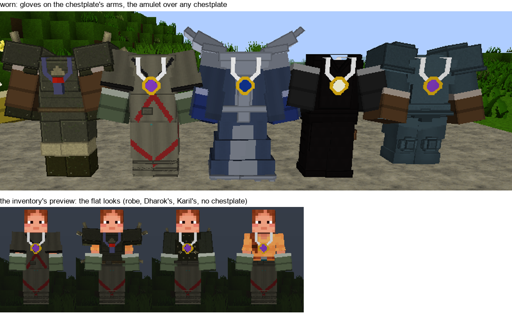
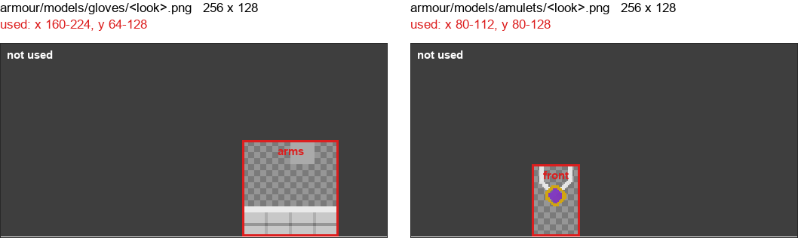
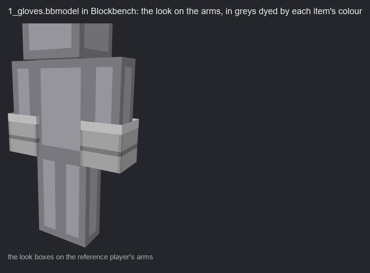
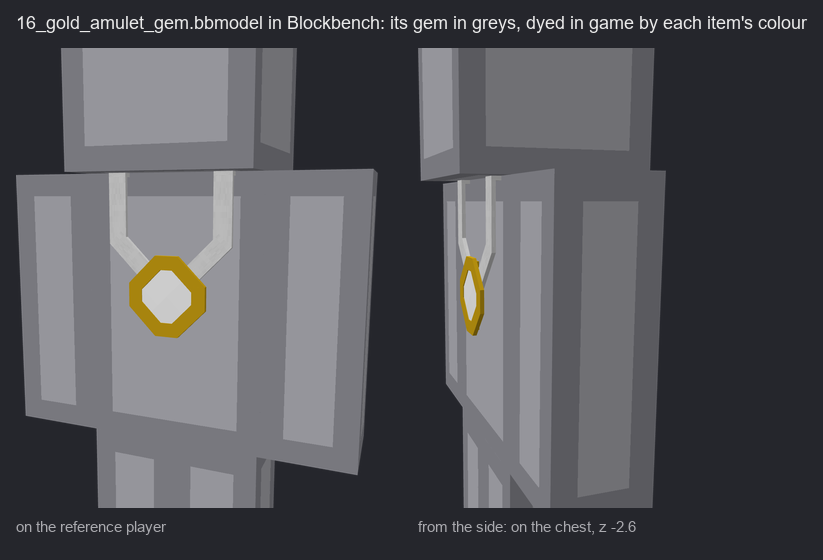
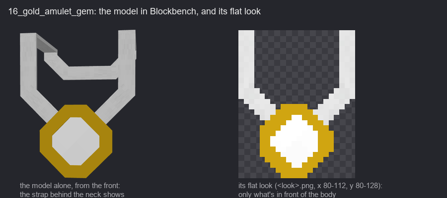
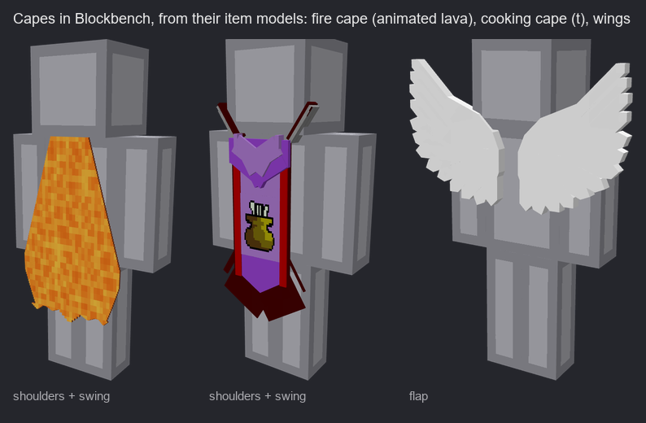

# MineScape armour: how to edit and add armour

Every MineScape body armour piece (platebodies, robes, dragonhide, plateskirts, boots and so on) is
defined in this folder. You edit Blockbench models and a small JSON file; the pack's build does the
rest: it paints each item in its colour onto the armour players wear, and makes its inventory icon (with
stack counts and the selection frame) to match.

You never touch the generated textures. Everything you need is in `armour/`:

```
armour/
  chest.json        every chestplate item: its look, colour, icon and shape
  legs.json         every leggings item
  boots.json        every boots item
  gloves.json       every gloves item, drawn on the chestplate's arms (4a)
  amulets.json      every amulet, drawn on the leggings' body over any chestplate (4a)
  capes.json        every cape, carried on the boots, hung on the back (4b)
  models/           the looks: one Blockbench model each, models/<piece>/<number>_<name>.bbmodel
  plain/            the plain looks (chest.png, legs.png, boots.png): leather the plugin doesn't define
  unused/           old looks no item wears, kept to build a model from
  layer_1_overlay.png, layer_2_overlay.png    shared overlays (rarely changed)
```

---

## 1. Looks: the models

A look is what a piece looks like worn, drawn in grey so one look can be used in many colours (the
same platebody in bronze, iron, rune...). Each look is a Blockbench model, `armour/models/<piece>/<look>.bbmodel`
(see [models/README.md](models/README.md)), and the model carries the flat look as its texture
`<look>.png`: the armour drawn on Minecraft's own boxes, which the build bakes into the armour sheets and
which players see wherever the model itself can't be drawn. Edit that texture in Blockbench (or export
it, paint it, and load it back); the model's other texture, `<look>_details.png`, is its extra parts.

The flat texture:

- **Size:** 256 x 128, Minecraft's armour layout (64 x 32) at 4 texels per pixel. Start from
  `plain/<piece>.png` or from a similar look.
- **Only your piece's part of the texture is used**; anything painted elsewhere is ignored:

  

  | Folder   | Area used (in the 256 x 128 file)                  | What it covers            |
  |----------|-----------------------------------------------------|---------------------------|
  | `chest/` | x 64-224, y 64-128                                  | body and both arms        |
  | `legs/`  | x 0-160, y 64-128                                   | both legs and the waist   |
  | `boots/` | x 0-64, y 64-128                                    | the bottom of the legs    |

- **Colours:**

  | You paint                                    | In game it is                                  |
  |----------------------------------------------|------------------------------------------------|
  | an exact grey (R = G = B), fully opaque       | dyed in the item's colour (darker grey, darker) |
  | any other colour                              | that colour, as painted (gold trims, gems...)   |
  | an exact grey with alpha 253                  | a light shade of the item's colour (trims)      |
  | anything with alpha 254                       | exactly as painted, even a grey                 |
  | alpha under 128                               | nothing (see-through)                           |

  Watch the greys: 120,120,121 is *not* a grey, so it keeps its own colour instead of being dyed.

  One file, every colour. Above, the gold trim keeps its own colour; below, the trim is a grey with
  alpha 253, a light shade of each colour:

  

- **Name:** the model is `<number>_<name>.bbmodel`, the number unique within its folder (use the next
  free one), the name anything readable: `76_dragon_platebody.bbmodel`, its flat texture
  `76_dragon_platebody.png` inside it. Items point at a look by this name.

Editing a look changes every item that uses it, in every colour.

## 2. Items: chest.json, legs.json, boots.json

Each item is one line in its piece's file:

```json
{"custom_model_data": 10095, "name": "ahrims_robeskirt", "look": "54_ahrims_robeskirt",
 "colour": "#3e3a3e", "icon": "ms:leggings/leather_plateskirt", "shape": "robe"}
```

| Field               | What it is                                                                                   |
|---------------------|----------------------------------------------------------------------------------------------|
| `custom_model_data` | The item's number: 10000 + 1 to 511, unique within the file. The server uses the same number. |
| `name`              | A label for people (the item's name in the plugin). Not used by the game.                     |
| `look`              | The look's model in `models/<piece>/`, without `.bbmodel`; or `plain`.                        |
| `colour`            | `#rrggbb`: the dye for the look's greys and for the icon.                                     |
| `icon`              | The inventory icon's item model (see 3).                                                      |
| `shape`             | How it sits on the body (legs and chest only, see below). Leave it out for `legs` / `none`.   |

Shapes:

- **legs.json:** `legs` (ordinary leggings), `skirt` (a plateskirt to below the knee, legs hidden),
  `robe` (to the ankle), `skirt_over_legs` (a skirt over visible legs, like Karil's or Guthan's).
- **chest.json:** `none`, `fauld` (plate below the waist, Dharok's), `jerkin`, `tunic` (to the thigh).


## 3. Icons

`icon` is the model the inventory icon is built from, usually a leather piece's model in
`assets/ms/models/` such as `ms:leggings/leather_plateskirt`. Its first layer (`layer0`, the grey
leather shape) is painted in the item's `colour`; any other layer (trims, overlays) keeps its own
colours. So a new icon is a grey base texture plus, if it needs one, a coloured overlay texture, in a
normal flat item model.


Several items can share one icon model, each in its own colour. An icon painted in full colour in
`layer0` (some boots are) is multiplied by the colour too: give such an item `#ffffff` to keep it as
painted.

## 4. Adding a new armour item

1. **Look:** reuse an existing look, or add `armour/models/<piece>/<next number>_<name>.bbmodel`
   (section 1): copy a similar look's model and change its textures and cubes.
2. **Icon:** reuse an icon model, or add a texture and a flat item model in `assets/ms/models/`.
3. **Entry:** add a line to `armour/<piece>.json` with the **next free `custom_model_data`** in that
   file, the look, colour, icon and shape.
4. **Tell the developer** the item's name and number. They add it in the plugin with that number,
   for example `new NormalLeatherArmorItems(Material.LEATHER_LEGGINGS, 10116, ...)`; it shows nothing in
   game until they do.

Changing an existing item (colour, look, icon, shape) needs only the JSON line; no developer, and
existing items in players' banks change with it.

`bare_arms` (chest 10094), `bare_legs` (legs 10115) and `bare_feet` (boots 10048) are not items: their
looks draw nothing, and the plugin sends them in place of armour that isn't worn, to carry gloves, an
amulet or a cape. Leave them be.

## 4a. Gloves and amulets

Gloves and amulets are ordinary items with their own numbers (1 to 4095, not 10000 +), worn in the
hands and neck slots. Minecraft has no such slots to draw, so they're drawn on the armour worn with
them: **gloves on the chestplate's arms, an amulet on the leggings' body**, over any chestplate. With no
chestplate or leggings worn, the plugin sends the bare ones (`bare_arms`, `bare_legs`) to carry them.



### The lists: gloves.json, amulets.json

One line an item, keyed by the item's own number:

```json
{"custom_model_data": 3814, "name": "graceful_gloves", "look": "1_gloves", "colour": "#6b7d5c"}
{"custom_model_data": 1046, "name": "dragonstone_amulet", "look": "16_gold_amulet_gem", "colour": "#823abe"}
```

| Field               | What it is                                                                          |
|---------------------|-------------------------------------------------------------------------------------|
| `custom_model_data` | The item's own number in the plugin (its `leather_horse_armor` model), 1 to 4095.    |
| `name`              | A label for people. Not used by the game.                                           |
| `look`              | The look's model, in `models/gloves/` or `models/amulets/`, without `.bbmodel`.      |
| `colour`            | Optional `#rrggbb`: dyes the look's exact greys. Without it they stay grey.          |

Many items share a look, each in its own colour: the gloves share `1_gloves` and the vambraces
`2_vambraces`. Amulets and necklaces that differ only in their gem share one look by their setting
(`16_gold_amulet_gem`, `40_silver_amulet_gem`, `27_gold_necklace_gem`, ...): its gold or silver is
painted as it is (alpha 254), its gem in exact greys, and each item's `colour` is its gem's, so the
sapphire, ruby, emerald and dragonstone amulets are one model. A new gem in an existing setting is
one line here. An item not listed draws nothing worn. New ones need nothing from the developer: the
plugin already sends every hands and neck item's number.

### What each texture covers

Both are 256 x 128 like any look, and only their own part is read:



| Folder             | Area used (in the 256 x 128 file) | What it covers                                        |
|--------------------|-----------------------------------|-------------------------------------------------------|
| `models/gloves/`   | x 160-224, y 64-128               | both arms (paint the hands and wrists, leave the rest clear) |
| `models/amulets/`  | x 80-112, y 80-128                | the body's front: the amulet's flat look              |

Colours follow the table in section 1: exact greys are dyed in the item's `colour`, alpha 254 keeps
its own colour (gold, gems), alpha under 128 draws nothing.

### Gloves

A glove look is flat: its texture `<look>.png`, painted on the arms. Open the model in Blockbench: the
`gloves` folder's `look right_arm` and `look left_arm` boxes show the texture on the reference player's
arms, so you can paint where the hands are. Paint it in Blockbench's Paint mode, or export the texture,
paint it elsewhere and load it back into the same texture, then save the project: the build reads the
texture stored inside the `.bbmodel`. Gloves draw over the chestplate's arms, its models too.
Blockbench shows the greys undyed: each item's `colour` dyes them in game.



### Amulets

An amulet look is a 3D model with a flat look for where the model can't be drawn.

- **The model:** its cubes go in the `amulet` folder's `body` group (pivot `0 24 0`, the neck), at most
  32 of them, each within 32 pixels of the pivot. **Build it on the bare body**, as it hangs on the
  player: the body's front is Blockbench z -2, the pendant about z -2.6, the chain round the neck. A
  part behind the neck is fine: the head and body hide it. The game sets everything in front of the
  body 1.5 pixels further out, so the amulet lies on any chestplate from every side; don't add that
  yourself.

  

- **Its colours:** the cubes' faces use `<look>_details.png`: alpha 254 for its own colours (most
  amulets), or exact greys to dye with the item's `colour`.
- **Its flat look, `<look>.png`:** the body's front (x 80-112, y 80-128), made from the model. It is
  what's in front of the body seen from the front, so the chain behind the neck isn't painted over the
  chest. Players see it in the inventory's preview, and wherever the model can't be drawn. **After
  changing the cubes or their colours, draw it again:**

  ```
  python .github/scripts/amulet_flat.py 16_gold_amulet_gem
  ```

  It writes the new image into the `.bbmodel` (reopen the model in Blockbench to see it). The build
  warns, naming them, about any amulet whose flat look doesn't match its model; `amulet_flat.py
  --check` lists them, and with no names it draws every one again.

  

- **An amulet with no cubes** is drawn flat everywhere: paint its `<look>.png` by hand, as for gloves.

Where it shows: the model in the world on every version (with the Stitch mod under shader packs),
over any chestplate, hidden from behind by the body and never in first person; the flat look in the
inventory's preview, where it's drawn over the chestplate too.

### Adding gloves or an amulet

1. **Look:** reuse one, or copy a similar look's `.bbmodel` in `models/gloves/` or `models/amulets/`
   to `<next number>_<name>.bbmodel`, and rename its two textures to match (`<look>.png`,
   `<look>_details.png`).
2. **Edit it** in Blockbench: gloves, paint `<look>.png`; an amulet, its cubes and
   `<look>_details.png`, then `python .github/scripts/amulet_flat.py <look>`.
3. **Entry:** a line in `gloves.json` or `amulets.json` with the item's own number from the plugin.
4. **Check it** (section 5).

## 4b. Capes

Capes are worn in the cape slot and carried in the worn boots' dye, as gloves are in the chestplate's;
with no boots worn, the plugin sends `bare_feet` boots to carry it. They're drawn on the back
over any armour, hidden in first person, and move as you walk.

### The list: capes.json

One line a cape, keyed by the item's own number, as for gloves and amulets:

```json
{"custom_model_data": 2874, "name": "firecape", "look": "3_firecape"}
```

The same fields as `gloves.json` (`colour` is optional and dyes exact greys). Many items can share a
look.

### The model

Each look is `armour/models/capes/<number>_<name>.bbmodel`, made cube for cube from the cape's item
model (`ms:capes/...`) and placed where that model used to hang. Open it in Blockbench: the outliner
has a **`cape`** folder with up to three groups, and the locked **player (reference)** to build round.

| Group | Its pivot | In game |
|---|---|---|
| `shoulders` | `0 24 0` | fixed to the body: the yoke and top of a cape, a bag, a pack |
| `swing` | the hinge, where it meets the shoulders | turns back about the hinge, about 4° standing and up to about 22° at full stride, and sways a few degrees side to side with each step, with a faint breeze standing still |
| `flap` | on the spine, at the wings' root | wings: each side turns back about the upright through the pivot, the sides opposite, about 14° standing and up to about 32° walking, about once every 1.6 s. Never forward into the body |



- **Build it on the back**, as it hangs: everything at Blockbench z 3.3 or more (a chestplate's back
  is z 3, its models a little further), from the shoulders (y about 25.5) down to the back of the
  knee (y about 6). Wings and packs can stand further out.
- **Pivots matter:** move a group's pivot and you move what it turns about. A `swing` pivot should sit
  on the cape's top edge, where it meets the shoulders; a `flap` pivot on the spine (x 0), at the
  height the wings join the back.
- **Textures:** `<look>_details.png` holds the faces' texels, in their own colours (alpha 254), or
  exact greys to dye with the item's `colour`. An animated texture, Blockbench's (its frames one under
  another, with its frame time and interpolation), animates in game too: the fire cape's lava is
  `3_firecape_animated.png`. `<look>.png` is left clear; a cape has no flat look.
- **Limits:** up to 200 cubes in all, any angle. Cubes as thin as a hundredth of a pixel are fine
  (a skill cape's emblem sits that far over its backing).
- **Where it shows:** wherever the tracer runs, on every release, and with the Stitch mod under shader
  packs. Not in the inventory's preview, and not for OptiFine without Stitch.

How far each part moves is a constant in `.github/scripts/armour_stitch.py`: `CAPE_REST`,
`CAPE_SWING`, `CAPE_SWAY` and `CAPE_BREEZE` for swinging, `CAPE_FLAP`, `CAPE_FLAP_WALK` and
`CAPE_FLAP_SECONDS` for flapping.

### Adding a cape

1. **Look:** reuse one, or copy a similar cape's `.bbmodel` to `<next number>_<name>.bbmodel` and
   rename its textures to match (`<look>.png`, `<look>_details.png`, and `<look>_animated.png` if it
   has one).
2. **Edit it** in Blockbench: its cubes in `shoulders`, `swing` or `flap`, each group's pivot where
   that part turns.
3. **Entry:** a line in `capes.json` with the item's own number from the plugin.
4. **Check it** (section 5): walk, and turn round it.

## 5. Seeing it

Pushing to the pack's `master` builds and releases it; reload the resource pack in game.

To build the generated files locally (Python with Pillow and NumPy):

```
python .github/scripts/amulet_flat.py         the amulets' flat looks, from their models (4a)
python .github/scripts/build_armour.py        the worn armour
python .github/scripts/count_icons.py         the icons
python .github/scripts/count_icons.py --restore
```

The build stops with a message naming the item if something is wrong: a look or icon file that
doesn't exist (or a model without its flat texture), a colour that isn't `#rrggbb`, a number used twice or outside 10001-10511, a shape
that isn't one of the above.

## Do not edit

These are made by the build and overwritten every time:

- `assets/minecraft/textures/models/armor/leather_layer_1.png`, `leather_layer_2.png`
- `assets/minecraft/textures/entity/equipment/humanoid*/leather*.png`
- anything in `assets/ms/models/count/` and `assets/minecraft/textures/item/custom/count/`
- `assets/minecraft/optifine/cit/minescape/` and the `cit_*` folders: each item's look as its own
  texture for OptiFine, so players using shader packs see the right armour too
- `assets/minescape/stitches/`: the armour for the Stitch mod, which keeps the looks and shapes under
  Iris shader packs
- the `custom_model_data` overrides the build adds to `leather_chestplate.json`, `leather_leggings.json`
  and `leather_boots.json` (the committed files keep only their old ones; run `--restore` after a
  local build)
