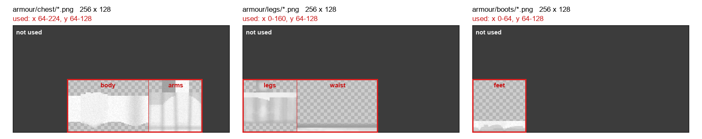
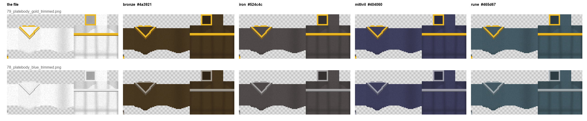
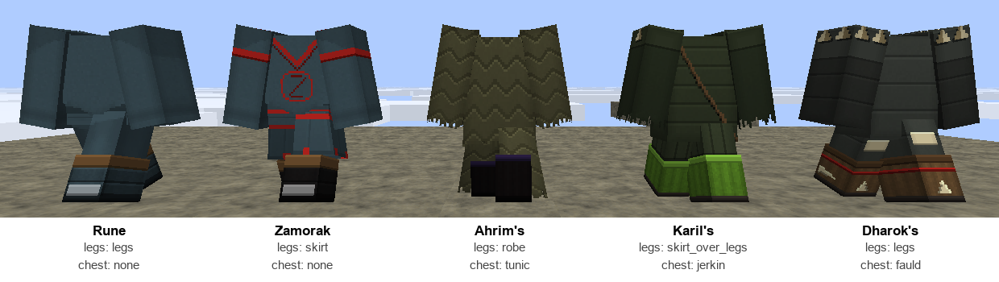
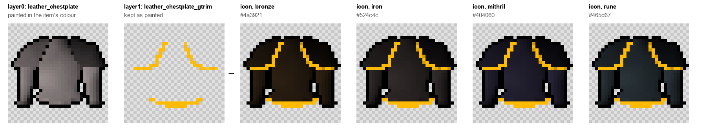

# MineScape armour: how to edit and add armour

Every MineScape body armour piece (platebodies, robes, dragonhide, plateskirts, boots and so on) is
defined in this folder. You edit pictures and a small JSON file; the pack's build does the rest: it
paints each item in its colour onto the armour players wear, and makes its inventory icon (with stack
counts and the selection frame) to match.

You never touch the generated textures. Everything you need is in `armour/`:

```
armour/
  chest.json        every chestplate item: its look, colour, icon and shape
  legs.json         every leggings item
  boots.json        every boots item
  chest/            the chest looks:  <number>_<name>.png, and plain.png
  legs/             the legs looks
  boots/            the boots looks
  layer_1_overlay.png, layer_2_overlay.png    shared overlays (rarely changed)
```

---

## 1. Looks: the PNG files

A look is what a piece looks like worn, drawn in grey so one look can be used in many colours (the
same platebody in bronze, iron, rune...).

- **Size:** 256 x 128, Minecraft's armour layout (64 x 32) at 4 texels per pixel. Start from
  `plain.png` in the same folder or from a similar look.
- **Only your piece's part of the texture is used**; anything painted elsewhere is ignored:

  

  | Folder   | Area used (in the 256 x 128 file)                  | What it covers            |
  |----------|-----------------------------------------------------|---------------------------|
  | `chest/` | x 64-224, y 64-128                                  | body and both arms        |
  | `legs/`  | x 0-160, y 64-128                                   | both legs and the waist   |
  | `boots/` | x 0-64, y 64-128                                    | the bottom of the legs    |

- **Colours:**

  | You paint                                    | In game it is                                  |
  |----------------------------------------------|------------------------------------------------|
  | an exact grey (R = G = B), fully opaque       | dyed in the item's colour (darker grey, darker) |
  | any other colour                              | that colour, as painted (gold trims, gems...)   |
  | an exact grey with alpha 253                  | a light shade of the item's colour (trims)      |
  | anything with alpha 254                       | exactly as painted, even a grey                 |
  | alpha under 128                               | nothing (see-through)                           |

  Watch the greys: 120,120,121 is *not* a grey, so it keeps its own colour instead of being dyed.

  One file, every colour. Above, the gold trim keeps its own colour; below, the trim is a grey with
  alpha 253, a light shade of each colour:

  

- **Name:** `<number>_<name>.png`, the number unique within its folder (use the next free one), the
  name anything readable: `76_dragon_platebody.png`. Items point at a look by this file name without
  `.png`.

Editing a look changes every item that uses it, in every colour.

## 2. Items: chest.json, legs.json, boots.json

Each item is one line in its piece's file:

```json
{"custom_model_data": 10095, "name": "ahrims_robeskirt", "look": "54_ahrims_robeskirt",
 "colour": "#3e3a3e", "icon": "ms:leggings/leather_plateskirt", "shape": "robe"}
```

| Field               | What it is                                                                                   |
|---------------------|----------------------------------------------------------------------------------------------|
| `custom_model_data` | The item's number: 10000 + 1 to 511, unique within the file. The server uses the same number. |
| `name`              | A label for people (the item's name in the plugin). Not used by the game.                     |
| `look`              | The look file in this piece's folder, without `.png`; or `plain`.                             |
| `colour`            | `#rrggbb`: the dye for the look's greys and for the icon.                                     |
| `icon`              | The inventory icon's item model (see 3).                                                      |
| `shape`             | How it sits on the body (legs and chest only, see below). Leave it out for `legs` / `none`.   |

Shapes:

- **legs.json:** `legs` (ordinary leggings), `skirt` (a plateskirt to below the knee, legs hidden),
  `robe` (to the ankle), `skirt_over_legs` (a skirt over visible legs, like Karil's or Guthan's).
- **chest.json:** `none`, `fauld` (plate below the waist, Dharok's), `jerkin`, `tunic` (to the thigh).



## 3. Icons

`icon` is the model the inventory icon is built from, usually a leather piece's model in
`assets/ms/models/` such as `ms:leggings/leather_plateskirt`. Its first layer (`layer0`, the grey
leather shape) is painted in the item's `colour`; any other layer (trims, overlays) keeps its own
colours. So a new icon is a grey base texture plus, if it needs one, a coloured overlay texture, in a
normal flat item model.



Several items can share one icon model, each in its own colour. An icon painted in full colour in
`layer0` (some boots are) is multiplied by the colour too: give such an item `#ffffff` to keep it as
painted.

## 4. Adding a new armour item

1. **Look:** reuse an existing look, or add `armour/<piece>/<next number>_<name>.png` (section 1).
2. **Icon:** reuse an icon model, or add a texture and a flat item model in `assets/ms/models/`.
3. **Entry:** add a line to `armour/<piece>.json` with the **next free `custom_model_data`** in that
   file, the look, colour, icon and shape.
4. **Tell the developer** the item's name and number. They add it in the plugin with that number,
   for example `new NormalLeatherArmorItems(Material.LEATHER_LEGGINGS, 10115, ...)`; it shows nothing in
   game until they do.

Changing an existing item (colour, look, icon, shape) needs only the JSON line; no developer, and
existing items in players' banks change with it.

## 5. Seeing it

Pushing to the pack's `master` builds and releases it; reload the resource pack in game.

To build the generated files locally (Python with Pillow and NumPy):

```
python .github/scripts/build_armour.py        the worn armour
python .github/scripts/count_icons.py         the icons
python .github/scripts/count_icons.py --restore
```

The build stops with a message naming the item if something is wrong: a look or icon file that
doesn't exist, a colour that isn't `#rrggbb`, a number used twice or outside 10001-10511, a shape
that isn't one of the above.

## Do not edit

These are made by the build and overwritten every time:

- `assets/minecraft/textures/models/armor/leather_layer_1.png`, `leather_layer_2.png`
- `assets/minecraft/textures/entity/equipment/humanoid*/leather*.png`
- anything in `assets/ms/models/count/` and `assets/minecraft/textures/item/custom/count/`
- the `custom_model_data` overrides the build adds to `leather_chestplate.json`, `leather_leggings.json`
  and `leather_boots.json` (the committed files keep only their old ones; run `--restore` after a
  local build)
